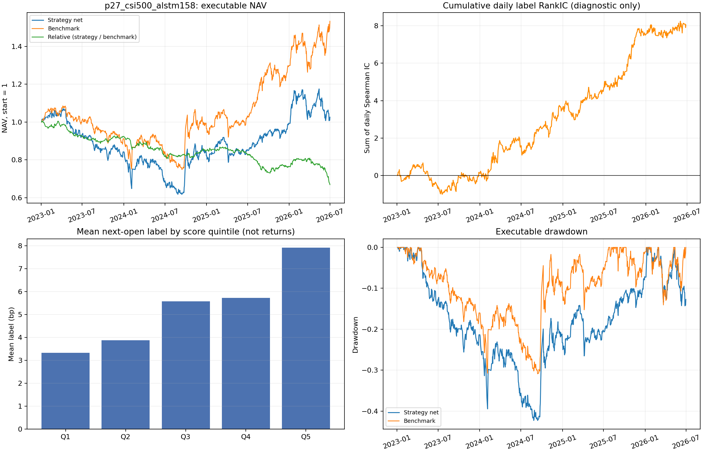

# P27 宇宙扩展终审报告

生成日期：2026-11-21。本报告由 `p27_p30_report.py` 从执行产物生成。

## 结论

| 候选 | 年化净超额 | 净 IR | MDD | 平均单边换手 | 平均现金权重 | 买入未成交率 | 双倍成本年化净超额 | DSR（trials） | 年度聚类 p／口径 | 判决 |
|---|---:|---:|---:|---:|---:|---:|---:|---:|---|---|
| P25（CSI300 冻结基线） | 5.31% | 0.633 | -20.19% | 9.66% | 6.74% | 12.17% | -1.57% | 0.365（9） | 0.277752／自身超额>0 | 冻结主口径；DSR 未过闸 |
| P27 CSI500／ALSTM158 | -11.53% | -1.494 | -42.30% | 9.62% | 2.62% | 7.66% | -18.38% | 5.52e-10（14） | 0.965698／自身超额>0 | rejected_annual_net_excess_positive |
| P30 开盘毛收益目标 | 6.14% | 0.693 | -22.92% | 9.59% | 7.14% | 14.41% | 0.02% | 0.020（14） | 0.497926／相对P25增量>0 | rejected_net_ir_gt_0_8 |
| P30 可执行净成本目标 | -4.01% | -0.433 | -28.94% | 9.53% | 7.53% | 16.03% | -11.26% | 1.83e-05（14） | 0.922767／相对P25增量>0 | rejected_annual_net_excess_positive |

## 累计收益与账户摩擦

| 候选 | 累计策略净收益 | 累计费用（元） | 累计滑点（元） | 平均持仓 |
|---|---:|---:|---:|---:|
| P25（CSI300 冻结基线） | 53.50% | 89780.26 | 176029.21 | 47.41 |
| P27 CSI500／ALSTM158 | 2.56% | 83641.85 | 161303.33 | 49.54 |
| P30 开盘毛收益目标 | 56.58% | 89350.90 | 175231.48 | 47.28 |
| P30 可执行净成本目标 | 10.53% | 85397.22 | 165271.70 | 47.14 |

费用和滑点是四个独立 fold 账户的累计名义金额，不是年化比率；累计策略净收益按逐日收益复利链接。

## 统计口径

- 正式窗口为 2023-01-03～2026-06-30，folds 8–11；P25 数值保持冻结，压力结果来自独立目录。
- 当前整批 DSR `n_trials=14`；Bonferroni 基数 `n=7`，阈值 `0.00714285714286`。
- P25 的 DSR 仍是其冻结时 `n_trials=9` 的历史判决；P27／P30 用当前整批真实可执行 SR 估计，不为数据闸失败项伪造收益。
- 试验间 SR 方差仅有 4/14 条真实可执行序列覆盖；旧候选 SR 未完整留存是残余限制，不能把这称作完整的历史 SR 台账，也不使用单序列方差回退。
- 所有候选即使全过也只进入 `pending_independent_review`，不自动解除生产冻结。

## 可执行净值与标签诊断

左上与右下来自逐日可执行账户；累计 RankIC 与五分位柱图仅是模型标签诊断，不是可成交收益，不参与调参或晋升。

## 数据闸事实

- 中证 500：2569 个交易日、1326 只历史成分，每日 500–500 只；真实快照 2547 日，22 个缺日只沿用此前快照，最大陈旧 20 个自然日。
- 数据健康：`passed=True`；真实快照覆盖率 99.14%；正式执行期必需原始行情 858 只，缺失 0。
- 涨跌停跨源核验：161673 行、192 只重叠股票，不一致 0 行；最大绝对差 0.00 元。
- 公司行动外连接：534 个事件、533 个匹配事件；裁决前候选单边 0、参考单边 1，裁决后未决缺失均为 0／0；现金／送转／支付日差异 0／0／0。
- 独立复原：参考缺失但由交易所参考价证实 1 件，候选缺失后按参考价补记 4 件，官方实施公告合并 1 件。证据与审计分别见 `data/p27_universe_expansion/meta/action_official_evidence.json`、`action_official_evidence_audit.json` 和 `action_cross_validation_detail.parquet`。
- 执行强制数据闸：`passed=True`；评分覆盖 858 只股票，公司行动缓存缺失 0 只。缺文件或任何跨源冲突都会在执行前抛错。
- 中证 1000：`rejected_gate0_data_health`，全历史 PIT 成分不足，**未训练、未看收益**。

## 分年可执行结果

| 候选 | 年度／fold | 年化净超额 | 净 IR | MDD | 买入未成交率 |
|---|---|---:|---:|---:|---:|
| P27 CSI500 | 2023／8 | -7.71% | -1.311 | -25.59% | 8.16% |
| P27 CSI500 | 2024／9 | -7.77% | -0.991 | -26.62% | 6.90% |
| P27 CSI500 | 2025／10 | -11.09% | -1.462 | -14.42% | 4.65% |
| P27 CSI500 | 2026／11 | -28.28% | -2.666 | -14.29% | 13.74% |

## 容量与可成交性

| 初始资金 | 年化净超额 | 净 IR | MDD | 平均／最大持仓 | 平均现金权重 | 买入未成交率 | 一手跳过率 | 成交额占比 p95／最大 |
|---:|---:|---:|---:|---:|---:|---:|---:|---:|
| 1 百万元 | -11.53% | -1.494 | -42.30% | 49.5／51 | 2.62% | 7.66% | 2.29% | 0.03%／0.15% |
| 10 百万元 | -11.57% | -1.522 | -43.45% | 49.7／51 | 1.68% | 5.36% | 0.00% | 0.31%／1.39% |
| 100 百万元 | -11.52% | -1.513 | -43.51% | 49.7／51 | 1.60% | 5.36% | 0.00% | 3.05%／13.67% |

成交额占比是事后诊断，不回填成交通知，也不冒充市场冲击模型。三档资金共享同一信号，不作为挑选参数。

## 终审闸门

- `p27_csi500_alstm158`：**rejected_annual_net_excess_positive**；失败闸门：annual_net_excess_positive、net_ir_gt_0_8、dsr_gte_0_95、at_least_3_of_4_years_positive、2025_2026_not_both_negative、double_cost_positive、bonferroni_increment、no_single_year_driver。

事实源：`data/p27_universe_expansion/metrics/final_verdict.json`、`data/p27_universe_expansion/capacity/summary.json`。
