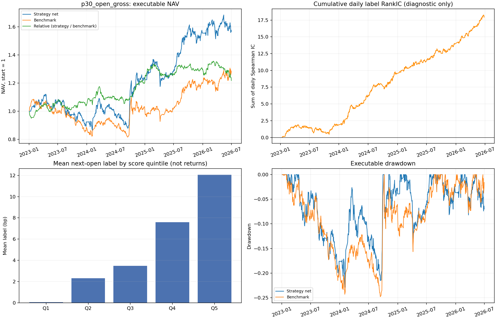
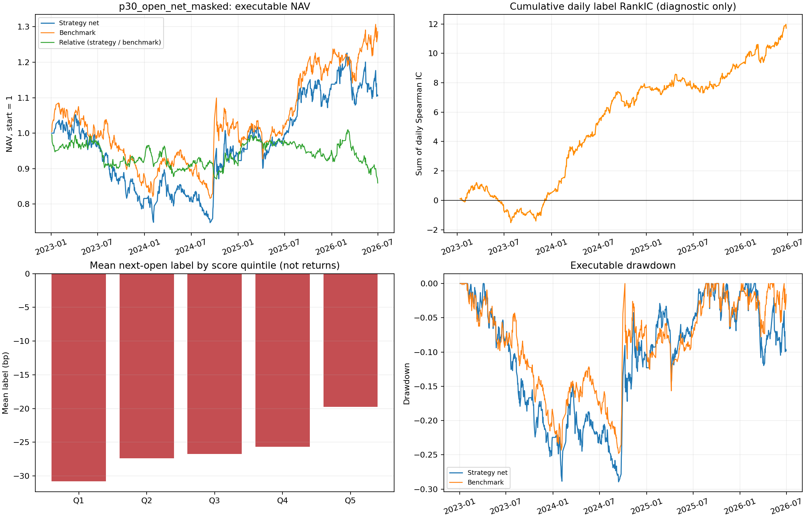

# P30 可执行成本感知目标终审报告

生成日期：2026-11-21。本报告由 `p27_p30_report.py` 从执行产物生成。

## 结论

| 候选 | 年化净超额 | 净 IR | MDD | 平均单边换手 | 平均现金权重 | 买入未成交率 | 双倍成本年化净超额 | DSR（trials） | 年度聚类 p／口径 | 判决 |
|---|---:|---:|---:|---:|---:|---:|---:|---:|---|---|
| P25（CSI300 冻结基线） | 5.31% | 0.633 | -20.19% | 9.66% | 6.74% | 12.17% | -1.57% | 0.365（9） | 0.277752／自身超额>0 | 冻结主口径；DSR 未过闸 |
| P27 CSI500／ALSTM158 | -11.53% | -1.494 | -42.30% | 9.62% | 2.62% | 7.66% | -18.38% | 5.52e-10（14） | 0.965698／自身超额>0 | rejected_annual_net_excess_positive |
| P30 开盘毛收益目标 | 6.14% | 0.693 | -22.92% | 9.59% | 7.14% | 14.41% | 0.02% | 0.020（14） | 0.497926／相对P25增量>0 | rejected_net_ir_gt_0_8 |
| P30 可执行净成本目标 | -4.01% | -0.433 | -28.94% | 9.53% | 7.53% | 16.03% | -11.26% | 1.83e-05（14） | 0.922767／相对P25增量>0 | rejected_annual_net_excess_positive |

## 累计收益与账户摩擦

| 候选 | 累计策略净收益 | 累计费用（元） | 累计滑点（元） | 平均持仓 |
|---|---:|---:|---:|---:|
| P25（CSI300 冻结基线） | 53.50% | 89780.26 | 176029.21 | 47.41 |
| P27 CSI500／ALSTM158 | 2.56% | 83641.85 | 161303.33 | 49.54 |
| P30 开盘毛收益目标 | 56.58% | 89350.90 | 175231.48 | 47.28 |
| P30 可执行净成本目标 | 10.53% | 85397.22 | 165271.70 | 47.14 |

费用和滑点是四个独立 fold 账户的累计名义金额，不是年化比率；累计策略净收益按逐日收益复利链接。

## 统计口径

- 正式窗口为 2023-01-03～2026-06-30，folds 8–11；P25 数值保持冻结，压力结果来自独立目录。
- 当前整批 DSR `n_trials=14`；Bonferroni 基数 `n=7`，阈值 `0.00714285714286`。
- P25 的 DSR 仍是其冻结时 `n_trials=9` 的历史判决；P27／P30 用当前整批真实可执行 SR 估计，不为数据闸失败项伪造收益。
- 试验间 SR 方差仅有 4/14 条真实可执行序列覆盖；旧候选 SR 未完整留存是残余限制，不能把这称作完整的历史 SR 台账，也不使用单序列方差回退。
- 所有候选即使全过也只进入 `pending_independent_review`，不自动解除生产冻结。

## 可执行净值与标签诊断

左上与右下来自逐日可执行账户；累计 RankIC 与五分位柱图仅是模型标签诊断，不是可成交收益，不参与调参或晋升。

## 分年可执行结果

| 候选 | 年度／fold | 年化净超额 | 净 IR | MDD | 买入未成交率 |
|---|---|---:|---:|---:|---:|
| P30 开盘毛收益 | 2023／8 | 4.49% | 0.569 | -20.44% | 11.23% |
| P30 开盘毛收益 | 2024／9 | 15.42% | 1.577 | -19.38% | 8.98% |
| P30 开盘毛收益 | 2025／10 | 8.07% | 1.029 | -14.08% | 15.13% |
| P30 开盘毛收益 | 2026／11 | -13.83% | -1.313 | -8.20% | 27.51% |
| P30 可执行净成本 | 2023／8 | -7.99% | -0.919 | -25.25% | 12.39% |
| P30 可执行净成本 | 2024／9 | -0.79% | -0.077 | -16.65% | 9.15% |
| P30 可执行净成本 | 2025／10 | 4.89% | 0.654 | -11.81% | 15.41% |
| P30 可执行净成本 | 2026／11 | -21.05% | -1.866 | -11.97% | 33.33% |

## 逐 fold 标签预测诊断

| 候选 | fold | 最佳 epoch | 验证集 IC | 测试 RankIC（诊断） | 测试 IC（诊断） |
|---|---:|---:|---:|---:|---:|
| p30_open_gross | 8 | 8 | 0.028155 | 0.007965 | 0.014826 |
| p30_open_gross | 9 | 7 | 0.019004 | 0.032860 | 0.026847 |
| p30_open_gross | 10 | 11 | 0.041820 | 0.019168 | 0.015489 |
| p30_open_gross | 11 | 2 | 0.021155 | 0.036746 | 0.042367 |
| p30_open_net_masked | 8 | 5 | 0.025279 | 0.001978 | 0.009847 |
| p30_open_net_masked | 9 | 8 | 0.022433 | 0.031030 | 0.029366 |
| p30_open_net_masked | 10 | 5 | 0.028199 | 0.006688 | 0.007427 |
| p30_open_net_masked | 11 | 1 | 0.024112 | 0.023281 | 0.038908 |

这些 RankIC／IC 只用于判断标签学习目标是否实现，不替代组合净收益，也不作为晋升证据。

## 终审闸门

- `p30_open_gross`：**rejected_net_ir_gt_0_8**；失败闸门：net_ir_gt_0_8、dsr_gte_0_95、bonferroni_increment、no_single_year_driver。
- `p30_open_net_masked`：**rejected_annual_net_excess_positive**；失败闸门：annual_net_excess_positive、net_ir_gt_0_8、dsr_gte_0_95、at_least_3_of_4_years_positive、double_cost_positive、bonferroni_increment、no_single_year_driver。

## 解释边界

- `open_gross` 只改变训练目标为 T+1 开盘到 T+2 开盘毛收益；执行仍完整扣费。
- `open_net_masked` 额外扣除固定参考成本并剔除不可买入样本；标签 RankIC 不是晋升依据。
- 两个候选的年度聚类检验均为与 P25 同日超额差的配对结果；不能和 P27 的自身超额检验混读。

事实源：`data/p30_execution_aware/metrics/final_p30_open_gross.json`、`data/p30_execution_aware/metrics/final_p30_open_net_masked.json`。
